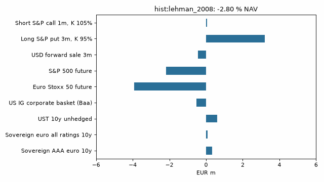

# stress-engine

[](https://github.com/louisdelacour21/stress-engine/actions/workflows/ci.yml)

Combined multi-factor stress tests on a synthetic 100 MEUR portfolio (9 lines, 10 market factors): crisis replay, conditional
propagation of partial shocks, full revaluation against sensitivities, reverse stress, and an out-of-sample test of the
propagation itself.

**Status: self-review by the author, synthetic portfolio, not an independent validation.** Results as of 2026-11-06
(panel fingerprint `729f210b935837fd`, data through the last available close).



## Results

| Scenario | P&L, % NAV | Mahalanobis d | Taylor-2 alert |
|---|---|---|---|
| hist:lehman_2008 | -2.80 | - | no |
| hist:sovereign_2011 | +0.35 | - | yes |
| hist:covid_2020 | -4.72 | - | yes |
| hist:rates_2022 | -12.24 | - | yes |
| hist:svb_2023 | +1.52 | - | no |
| hypo:stagflation | -8.12 | 13.1 | no |
| hypo:fragmentation | -0.64 | 16.6 | no |
| hypo:flight_to_quality | -1.86 | 5.7 | no |
| hypo:strong_dollar | +1.38 | 9.8 | no |

Per-line P&L, grids and reverse stress are in `outputs/`; the validation report is `outputs/validation_report.pdf`.

## What the tests found (this is the useful part)

* **The Gaussian propagation fails its own backtest.** On 424 non-overlapping 10-day periods (pilot Euro Stoxx 50 and US 10y) the KS test
  rejects 94% of the factor/pilot pairs; a Student-t version (nu = 5, fixed in advance, not tuned) cuts this to
  78%. The nominal 90 % band covers 90%-98%: too wide. Mahalanobis d is an ordinal scale, never a return period.
* **The covariance regime moves the answer.** The `fragmentation` scenario costs -0.6 % of NAV with the full sample,
  -0.0 % with stressed periods, -4.3 % since 2021.
* **Basis risk on the corporate line.** LQD regressed on the BAA10Y spread implies a duration of 3.6
  (R2 0.10, 10-day tracking error 1.6 %), far from the modelled 8.
* **Sensitivities break on crisis-sized moves** (Taylor-2 alert on 3 of 9 scenarios), mainly the options and convexity.
* Ill-conditioned shock sets (cond(S_ss) > 1e6) are flagged, not hidden.

## Method
* Ten factors: EUR 2y/10y AAA (ECB), EUR sovereign spread, US 2y/10y (FRED), BAA10Y, VIX, EURUSD, Euro Stoxx 50, S&P 500. Rates and spreads in bp, others in log-changes.
* Shocks are instantaneous (no theta, no expiry). Bonds on a two-pillar zero curve, Black-Scholes options with ATM vol = VIX. Cross-checked against QuantLib (gap 0.00976 % of nominal) and the textbook control cases in `tests/`.
* Covariance: EWMA 0.97 + Ledoit-Wolf, square-root-of-time to 10 days (ignores autocorrelation and vol clustering: a stated limit), three regimes.
* Partial shocks completed by conditional Gaussian propagation; P&L bands from conditional draws.
* Reverse stress: closed form on the deltas, then bisection with full revaluation along that direction (not the exact optimum for a non-linear book).

## Use
```
pip install -e ".[data,check,media,dev]"
make reproduce                          # about 15 s, rewrites outputs/
stress-engine scenario eur_10y=150 sx5e=-0.15 --regime stressed
stress-engine reverse 10                # most plausible move losing 10 % of NAV
stress-engine bench                     # 100k full revaluations
streamlit run app.py                    # demo on the precomputed outputs
```
Raw series are not redistributed (Yahoo, Cboe, ICE licences): the loaders download them and `outputs/` holds derived numbers only. Tests: 15, coverage above 90 %, CI on every push.

## Not done
Student copula for the joint shocks, Shapley attribution, stressed expected shortfall, EBA mapping, full vol surface, BTP-Bund spread.

MIT licence.
